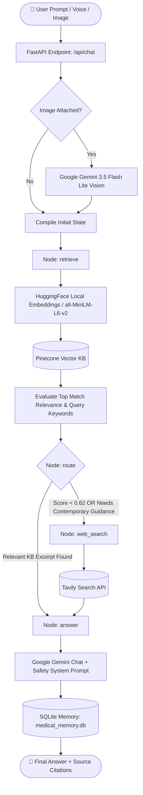

# 🏥 MedGuide AI — Agentic Medical Assistant

[](https://www.python.org/)
[](https://fastapi.tiangolo.com/)
[](https://langchain-ai.github.io/langgraph/)
[](https://aistudio.google.com/)
[](https://huggingface.co/)
[](https://www.pinecone.io/)
[](https://microsoft.com/windows)

> **MedGuide AI** is an advanced, multimodal educational medical agent built with **LangGraph**, **FastAPI**, **Pinecone Vector Database**, and **Google Gemini**. It runs with **zero paid OpenAI dependencies**, leveraging **Google Gemini 3.5 Flash Lite (free tier via Google AI Studio)** for intelligent chat and vision reasoning, **free local HuggingFace embeddings (`all-MiniLM-L6-v2`)**, automated routing to **Tavily Web Search** for real-time clinical guidelines, browser-native speech input/output, and persistent SQLite memory.

---

## 📸 System Architecture


---

## ✨ Core Features (100% Free Tier & Local Compatible)

- 🧠 **Google Gemini 3.5 Flash Lite**: Powered by Google's state-of-the-art, high-speed, and free-tier accessible Gemini models for clinical triage guidance and reasoning.
- 🆓 **Free Local Hugging Face Embeddings**: Uses `sentence-transformers/all-MiniLM-L6-v2` locally on your machine with 384 dimensions. No paid API tokens or credit card needed for vector embeddings!
- 🔀 **Autonomous Agentic Decision Graph (LangGraph)**: Evaluates vector relevance scores against indexed literature. If confidence is below threshold (< 0.62) or queries request contemporary treatments, it automatically routes to live web search.
- 📚 **Vector RAG (Pinecone + PyMuPDF)**: Indexes and retrieves verified medical literature chunk-by-chunk with cosine similarity matching and source page citations (`[PDF p.X]`).
- 🌐 **Real-time Web Guidance (Tavily)**: Pulls up-to-date guidance from authoritative medical sources when local references are insufficient.
- 👁️ **Multimodal Vision (Gemini Vision)**: Inspects user-provided medical imagery (webcam snapshot or file upload) using Gemini Vision with strict diagnostic guardrails.
- 🎙️ **Free Voice Input & Audio Output**: Zero-latency, 100% free browser-native **Web Speech Recognition** and **Speech Synthesis** (works seamlessly in Windows Edge and Chrome).
- 💾 **Persistent Session Memory (SQLite)**: Saves and resumes conversational context across multiple turns using LangGraph's `SqliteSaver` checkpointer (`medical_memory.db`).
- 🛡️ **Clinical Guardrails & Triage Protocols**: Automatically detects life-threatening emergency symptoms and advises emergency services immediately.

---

## 🔄 Agentic Workflow



---

## 📁 Repository Structure

```plaintext
Medical_agentic_chatbot/
│
├── app/
│   ├── __init__.py           # Package marker
│   ├── agent.py              # LangGraph StateGraph, nodes, Gemini LLM & SQLite checkpointer
│   ├── config.py             # Settings, Gemini models, HuggingFace embeddings & Windows SSL fix
│   ├── knowledge.py          # Free HuggingFace embeddings + Pinecone vector search
│   └── main.py               # FastAPI server, endpoints (/api/chat, /api/health, etc.)
│
├── data/
│   └── Medical_book.pdf      # Reference medical literature (Gale Encyclopedia)
│
├── docs/
│   └── Medical AI Agent Architecture Infographic.png # System diagram
│
├── static/
│   ├── app.js                # Frontend controller (Chat, Web Speech API, Camera, Audio)
│   └── style.css             # Responsive styling & layout
│
├── templates/
│   └── index.html            # Web user interface
│
├── .env                      # API keys & configuration (configure this)
├── .gitignore                # Git ignore patterns
├── inject.py                 # PDF ingestion script (splits, embeds & upserts to Pinecone)
├── medical_memory.db         # Persistent SQLite session store (auto-generated)
├── requirements.txt          # Python dependencies
└── README.md                 # Project documentation
```

---

## 🪟 Windows Setup & Installation Guide

This guide is tailored specifically for **Windows 10 / Windows 11** using **PowerShell**, **Command Prompt (CMD)**, or **Anaconda / Miniconda**.

### 1. Prerequisites

- **Python 3.11 or 3.12** installed ([Python.org](https://www.python.org/downloads/)) or **Conda** ([Miniconda](https://docs.conda.io/en/latest/miniconda.html)).
  *Ensure **"Add python.exe to PATH"** was checked during Python installation.*
- **Git for Windows** ([git-scm.com](https://git-scm.com/download/win)).
- **Free API Keys**:
  - [Google AI Studio API Key](https://aistudio.google.com/) (**100% Free** for Gemini 3.5 Flash Lite)
  - [Pinecone API Key](https://app.pinecone.io/) (**Free Tier** serverless index)
  - [Tavily API Key](https://app.tavily.com/) *(Free 1,000 requests/month, optional for web search)*

---

### 2. Clone the Repository

Open **PowerShell** or **Command Prompt** and run:

```powershell
git clone https://github.com/your-username/Medical_agentic_chatbot.git
cd Medical_agentic_chatbot
```

---

### 3. Create & Activate Virtual Environment

Choose **Option A (Conda)** or **Option B (Python venv)**:

#### Option A: Using Conda (Recommended)

```powershell
# Create environment with Python 3.11
conda create -n medguide python=3.11 -y

# Activate environment
conda activate medguide
```

#### Option B: Using Python venv (Built-in)

```powershell
# Create virtual environment
python -m venv .venv

# If PowerShell blocks scripts, enable execution:
Set-ExecutionPolicy -ExecutionPolicy RemoteSigned -Scope CurrentUser

# Activate virtual environment
.venv\Scripts\Activate.ps1
```
*(In standard Command Prompt `cmd.exe`, run: `.venv\Scripts\activate.bat`)*

---

### 4. Install Dependencies

Install all required packages (including HuggingFace `sentence-transformers` and Google GenAI):

```powershell
python -m pip install --upgrade pip
pip install -r requirements.txt
```

---

### 5. Configure Environment Variables (`.env`)

Create or update your `.env` file in the root directory:

```ini
# Google Gemini (Get free key from https://aistudio.google.com/)
GEMINI_API_KEY=AIzaSyYourGeminiApiKeyHere
GEMINI_CHAT_MODEL=gemini-3.5-flash-lite
GEMINI_VISION_MODEL=gemini-3.5-flash-lite
GEMINI_EMBED_MODEL=models/text-embedding-004

# Embedding Configuration
# "huggingface" = 100% free local embeddings (sentence-transformers/all-MiniLM-L6-v2)
# "gemini"      = Google Gemini API embeddings (models/text-embedding-004)
EMBEDDING_PROVIDER=huggingface
HUGGINGFACE_MODEL_NAME=sentence-transformers/all-MiniLM-L6-v2

# Pinecone Vector Database
PINECONE_API_KEY=yourPineconeApiKeyHere
PINECONE_INDEX=medical-agent-demo
# 384 for sentence-transformers/all-MiniLM-L6-v2 | 768 for models/text-embedding-004
PINECONE_DIMENSION=384

# Tavily (Optional real-time clinical web search)
TAVILY_API_KEY=tvly-yourTavilyApiKeyHere

# API Security (Optional)
API_TOKEN=
ALLOWED_ORIGINS=http://localhost:8000,http://127.0.0.1:8000
```

> [!TIP]
> **Windows SSL Workaround**: `app/config.py` automatically injects `certifi.where()` into `SSL_CERT_FILE` to prevent SSL verification errors commonly encountered in Conda and Windows corporate environments.

---

### 6. Ingest the Medical PDF with Free Embeddings

Before launching the chatbot for the first time, chunk and embed the medical book into your Pinecone serverless vector index using free local HuggingFace embeddings:

```powershell
python inject.py --pdf data/Medical_book.pdf
```

- Creates a serverless index named `medical-agent-demo` with **384 dimensions** (matching `all-MiniLM-L6-v2`).
- Chunks text with an overlap algorithm and SHA-256 deduplication.
- Runs completely on your local machine with zero embedding API cost.
- Logs real-time indexing progress in your terminal.

---

### 7. Run the Application

Start the FastAPI application with `uvicorn`:

```powershell
uvicorn app.main:app --reload --host 127.0.0.1 --port 8000
```

Open your browser and navigate to:
- 🌐 **Web Chat Interface**: [http://127.0.0.1:8000](http://127.0.0.1:8000)
- 📖 **Interactive OpenAPI / Swagger Docs**: [http://127.0.0.1:8000/docs](http://127.0.0.1:8000/docs)
- 🩺 **Health Check**: [http://127.0.0.1:8000/api/health](http://127.0.0.1:8000/api/health)

---

## 📡 API Reference

| Method | Endpoint | Description | Payload / Headers |
|---|---|---|---|
| `GET` | `/` | Serves the web interface (`index.html`) | None |
| `GET` | `/api/health` | Verifies Gemini, Pinecone, and Tavily status | None |
| `POST` | `/api/chat` | Main agentic chat interaction | `{"message": str, "history": list, "image_data": str \| null}` |
| `POST` | `/api/transcribe` | Free audio transcription fallback | `multipart/form-data` (`file`: audio/webm) |
| `POST` | `/api/speak` | Free TTS audio fallback | `{"text": str}` |

---

## 💡 Using the Web Interface

1. **Ask Medical Questions**: Type questions or symptoms into the input box.
2. **Visual Observation (Gemini Vision)**:
   - Click **"📎 Image"** to attach a photo (`PNG`, `JPEG`, `WebP` < 5MB).
   - Click **"📷 Camera"** to take a live photo directly from your webcam.
3. **Free Voice Input**: Click **"🎤 Voice"** to speak. The browser transcribes your voice directly using native Web Speech Recognition with zero cost.
4. **Free Voice Output**: Click **"🔊 Read answer"** to hear the assistant speak its response using the browser's built-in natural speech synthesis.
5. **Inspect Citations**: Click the bottom of assistant bubbles to see exact `[PDF page X]` or web citations.

---

## 🔧 Windows Troubleshooting & FAQ

<details>
<summary><b>1. PowerShell says: "execution of scripts is disabled on this system"</b></summary>

PowerShell restricts running scripts by default on Windows. Run this command once in PowerShell:
```powershell
Set-ExecutionPolicy -ExecutionPolicy RemoteSigned -Scope CurrentUser
```
Then reactivate your environment with `.venv\Scripts\Activate.ps1`.
</details>

<details>
<summary><b>2. SSL / Certificate Verification Errors in Python or Conda</b></summary>

If you encounter `SSLCertVerificationError` or `CERTIFICATE_VERIFY_FAILED`, `app/config.py` is configured to resolve this automatically using `certifi`. If it persists in custom scripts:
```powershell
pip install --upgrade certifi
$env:SSL_CERT_FILE = python -c "import certifi; print(certifi.where())"
```
</details>

<details>
<summary><b>3. Pinecone Dimension Mismatch Error</b></summary>

If you previously created an index for OpenAI (which used 1536 dimensions), Pinecone will throw an error because HuggingFace `all-MiniLM-L6-v2` produces 384 dimensions.
**Solution**:
1. Log in to [app.pinecone.io](https://app.pinecone.io/) and delete the old index, OR change `PINECONE_INDEX=medical-agent-gemini` in `.env`.
2. Re-run `python inject.py --pdf data/Medical_book.pdf`.
</details>

<details>
<summary><b>4. Microphone or Camera Not Working in the Browser</b></summary>

Modern web browsers only allow microphone and camera access on secure contexts:
- Use `http://localhost:8000` or `http://127.0.0.1:8000`.
- Ensure browser permissions for camera and microphone are set to "Allow" in site settings.
- Check Windows Privacy settings: **Windows Settings > Privacy & Security > Microphone / Camera** and ensure access is toggled **ON**.
</details>

<details>
<summary><b>5. How do I switch to Google Gemini embeddings instead of Hugging Face?</b></summary>

In your `.env` file, change:
```ini
EMBEDDING_PROVIDER=gemini
PINECONE_DIMENSION=768
```
Then delete/recreate your Pinecone index and run `python inject.py`.
</details>

---

## ⚖️ Medical & Ethical Disclaimer

> [!WARNING]
> **MEDGUIDE AI IS FOR EDUCATIONAL AND INFORMATIONAL PURPOSES ONLY.**
> 
> - **Not a Clinician**: This system is **NOT** a certified medical professional and cannot provide official medical diagnoses, clinical evaluations, or prescriptions.
> - **Historical Data Notice**: The bundled *Gale Encyclopedia of Medicine* (2002) is a historical medical reference; medical science progresses rapidly, and historical entries may not reflect current treatment standards.
> - **Visual Assessment**: Image inspection is descriptive only and cannot confirm or rule out medical conditions.
> - **Emergencies**: If you or someone around you is experiencing life-threatening symptoms (e.g., severe chest pain, shortness of breath, signs of stroke, acute trauma), **contact emergency medical services (such as 911 or 112) immediately.**

---

## 📜 License

This project is licensed under the terms of the [MIT License](LICENSE).