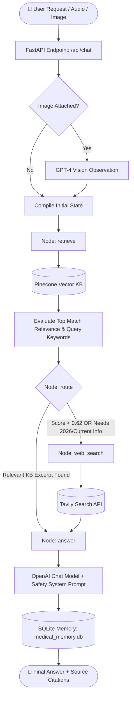

# 🏥 MedGuide AI — Agentic Medical Assistant

[](https://www.python.org/)
[](https://fastapi.tiangolo.com/)
[](https://langchain-ai.github.io/langgraph/)
[](https://www.pinecone.io/)
[](https://openai.com/)
[](https://microsoft.com/windows)

> **MedGuide AI** is an advanced, multimodal educational medical agent built with **LangGraph**, **FastAPI**, **Pinecone Vector Database**, and **OpenAI**. It features dynamic knowledge retrieval from the *Gale Encyclopedia of Medicine*, intelligent automated routing to **Tavily Web Search** for real-time medical updates, image observation with Vision models, speech-to-text (Whisper), text-to-speech (TTS), and persistent SQLite memory.

---

## 📸 System Architecture


---

## ✨ Core Features

- 🧠 **Agentic Decision Graph (LangGraph)**: Evaluates semantic relevance scores from local vector knowledge. If confidence is low or if queries request contemporary treatments/guidelines, it autonomously triggers external live search.
- 📚 **Vector RAG (Pinecone + PyMuPDF)**: Indexes and retrieves verified medical literature chunk-by-chunk with cosine similarity matching and source page citations (`[PDF p.X]`).
- 🌐 **Real-time Web Search Fallback (Tavily)**: Pulls up-to-date clinical guidance from reputable online medical resources when local indexed books have gaps.
- 👁️ **Multimodal Vision Observations**: Inspects user-provided medical imagery (camera snapshot or file upload) using vision models with clinical guardrails (describes observations without asserting definitive diagnoses).
- 🎙️ **Voice In & Voice Out**: Hands-free interactions via client-side recording, server-side **Whisper-1** transcription, and **TTS-1** audio playback.
- 💾 **Persistent Threaded Memory (SQLite)**: Preserves conversation history per session using LangGraph's `SqliteSaver` checkpointer.
- 🛡️ **Safety & Triage Guardrails**: System-level emergency detection that automatically redirects critical situations (e.g., chest pain, shortness of breath, severe bleeding) to emergency services immediately.

---

## 🔄 Agentic Workflow



---

## 📁 Repository Structure

```plaintext
Medical_agentic_chatbot/
│
├── app/
│   ├── __init__.py           # Package marker
│   ├── agent.py              # LangGraph StateGraph, nodes, routing & SQLite saver
│   ├── config.py             # Pydantic Settings, environment variables & Windows SSL fix
│   ├── knowledge.py          # Pinecone client, text embeddings & vector query
│   └── main.py               # FastAPI server, endpoints (/api/chat, /api/transcribe, etc.)
│
├── data/
│   └── Medical_book.pdf      # Reference medical literature (Gale Encyclopedia)
│
├── docs/
│   └── Medical AI Agent Architecture Infographic.png # System diagram
│
├── static/
│   ├── app.js                # Frontend controller (Chat, Audio recorder, Camera, TTS)
│   └── style.css             # Responsive styling & layout
│
├── templates/
│   └── index.html            # Web user interface
│
├── .env                      # API keys & configuration (create this)
├── .gitignore                # Git ignore patterns
├── inject.py                 # PDF ingestion script (splits, embeds & upserts to Pinecone)
├── medical_memory.db         # Persistent SQLite session store (auto-generated)
├── requirements.txt          # Python dependencies
└── README.md                 # Project documentation
```

---

## 🪟 Windows Setup & Installation Guide

This guide is tailored specifically for **Windows 10 / Windows 11** using **PowerShell**, **Command Prompt (CMD)**, or **Anaconda / Miniconda**.

### 1. Prerequisites

- **Python 3.11 or 3.12** installed ([Python.org](https://www.python.org/downloads/)) or **Conda** ([Miniconda](https://docs.conda.io/en/latest/miniconda.html)).
  *Ensure **"Add python.exe to PATH"** was checked during Python installation.*
- **Git for Windows** ([git-scm.com](https://git-scm.com/download/win)).
- API Keys:
  - [OpenAI API Key](https://platform.openai.com/api-keys) (for chat, embeddings, Whisper, and TTS)
  - [Pinecone API Key](https://app.pinecone.io/) (for vector storage)
  - [Tavily API Key](https://app.tavily.com/) *(optional but recommended for web search)*

---

### 2. Clone the Repository

Open **PowerShell** or **Command Prompt** and run:

```powershell
git clone https://github.com/your-username/Medical_agentic_chatbot.git
cd Medical_agentic_chatbot
```

---

### 3. Create & Activate Virtual Environment

Choose **Option A (Conda)** or **Option B (Standard Python venv)**:

#### Option A: Using Conda (Recommended)

```powershell
# Create environment
conda create -n medguide python=3.11 -y

# Activate environment
conda activate medguide
```

#### Option B: Using Python venv (Built-in)

```powershell
# Create virtual environment
python -m venv .venv

# If using PowerShell and execution is blocked, enable script execution:
Set-ExecutionPolicy -ExecutionPolicy RemoteSigned -Scope CurrentUser

# Activate virtual environment
.venv\Scripts\Activate.ps1
```
*(In standard Command Prompt `cmd.exe`, run: `.venv\Scripts\activate.bat`)*

---

### 4. Install Dependencies

Upgrade `pip` and install all required packages:

```powershell
python -m pip install --upgrade pip
pip install -r requirements.txt
```

---

### 5. Configure Environment Variables (`.env`)

Create a `.env` file in the project root directory:

```powershell
# In PowerShell:
New-Item -Path .env -ItemType File -Force
```

Open `.env` in Notepad or VS Code and configure your API keys:

```ini
# OpenAI
OPENAI_API_KEY=sk-proj-yourOpenAiApiKeyHere
OPENAI_CHAT_MODEL=gpt-4.1-mini
OPENAI_EMBED_MODEL=text-embedding-3-small
OPENAI_VISION_MODEL=gpt-4.1-mini

# Pinecone
PINECONE_API_KEY=yourPineconeApiKeyHere
PINECONE_INDEX=medical-agent-demo

# Tavily (Live Web Guidance)
TAVILY_API_KEY=tvly-yourTavilyApiKeyHere

# Optional API Security
API_TOKEN=
ALLOWED_ORIGINS=http://localhost:8000,http://127.0.0.1:8000
```

> [!TIP]
> **Windows SSL Workaround**: `app/config.py` automatically injects `certifi.where()` into `SSL_CERT_FILE` to prevent SSL verification errors commonly encountered in Conda and Windows corporate environments.

---

### 6. Ingest the Medical PDF into Pinecone

Before launching the chatbot for the first time, chunk and embed the medical book into your Pinecone serverless vector index.

Make sure your PDF is located at `data/Medical_book.pdf`, then run:

```powershell
python inject.py --pdf data/Medical_book.pdf
```

- Creates a serverless index named `medical-agent-demo` (1536 dimensions, cosine metric) if it does not already exist.
- Chunks text with an overlap algorithm and SHA-256 deduplication.
- Batches vector uploads (50 chunks per batch) with real-time console progress.

---

### 7. Run the Application

Start the FastAPI application using `uvicorn`:

```powershell
uvicorn app.main:app --reload --host 127.0.0.1 --port 8000
```

Open your browser and navigate to:
- 🌐 **Web Chat Interface**: [http://127.0.0.1:8000](http://127.0.0.1:8000)
- 📖 **Interactive OpenAPI / Swagger Docs**: [http://127.0.0.1:8000/docs](http://127.0.0.1:8000/docs)
- 🩺 **Health Check**: [http://127.0.0.1:8000/api/health](http://127.0.0.1:8000/api/health)

---

## 📡 API Reference

| Method | Endpoint | Description | Payload / Headers |
|---|---|---|---|
| `GET` | `/` | Serves the web interface (`index.html`) | None |
| `GET` | `/api/health` | Verifies OpenAI, Pinecone, and Tavily status | None |
| `POST` | `/api/chat` | Main agentic chat interaction | `{"message": str, "history": list, "image_data": str \| null}` |
| `POST` | `/api/transcribe` | Transcribes audio via Whisper-1 | `multipart/form-data` (`file`: audio/webm) |
| `POST` | `/api/speak` | Converts bot response to speech via TTS-1 | `{"text": str}` |

---

## 💡 Using the Web Interface

1. **Ask Medical Inquiries**: Type symptom descriptions or questions in the chat box.
2. **Visual Observation**:
   - Click **"📎 Image"** to attach a photo (`PNG`, `JPEG`, `WebP` < 5MB).
   - Click **"📷 Camera"** to capture a live snapshot directly from your webcam.
3. **Voice Input (Speech-to-Text)**:
   - Click **"🎤 Voice"** to speak. Click **"⏹ Stop recording"** when done; Whisper will transcribe your voice into the message prompt.
4. **Voice Output (Text-to-Speech)**:
   - Click **"🔊 Read answer"** to hear the assistant vocalize its response.
5. **Inspect Sources**: Expand the bottom of assistant bubbles to see exact `[PDF page X]` or web citations.

---

## 🔧 Windows Troubleshooting & FAQ

<details>
<summary><b>1. PowerShell says: "execution of scripts is disabled on this system"</b></summary>

PowerShell restricts running scripts by default on Windows. Run this command once in PowerShell:
```powershell
Set-ExecutionPolicy -ExecutionPolicy RemoteSigned -Scope CurrentUser
```
Then reactivate your environment with `.venv\Scripts\Activate.ps1`.
</details>

<details>
<summary><b>2. SSL / Certificate Verification Errors in Python or Conda</b></summary>

If you encounter `SSLCertVerificationError` or `CERTIFICATE_VERIFY_FAILED`, `app/config.py` is configured to resolve this automatically using `certifi`. If it persists in custom scripts:
```powershell
pip install --upgrade certifi
$env:SSL_CERT_FILE = python -c "import certifi; print(certifi.where())"
```
</details>

<details>
<summary><b>3. Microphone or Camera Not Working in the Browser</b></summary>

Modern web browsers only allow microphone and camera access on secure contexts:
- Use `http://localhost:8000` or `http://127.0.0.1:8000`.
- Ensure browser permissions for camera and microphone are set to "Allow" in site settings.
- Check Windows Privacy settings: **Windows Settings > Privacy & Security > Microphone / Camera** and ensure access is toggled **ON**.
</details>

<details>
<summary><b>4. HTTP 502 / AI Service Failed</b></summary>

- Verify your `.env` contains valid, active API keys.
- Check your OpenAI usage tier and billing status.
- Ensure the Pinecone index exists and has finished provisioning.
- Confirm index dimension matches your embedding model: `1536` for `text-embedding-3-small`.
</details>

<details>
<summary><b>5. No Knowledge Base Matches Returned</b></summary>

- Make sure `python inject.py --pdf data/Medical_book.pdf` completed successfully.
- Verify that `PINECONE_INDEX` in `.env` matches the index name populated during ingestion (`medical-agent-demo`).
</details>

---

## ⚖️ Medical & Ethical Disclaimer

> [!WARNING]
> **MEDGUIDE AI IS FOR EDUCATIONAL AND INFORMATIONAL PURPOSES ONLY.**
> 
> - **Not a Clinician**: This system is **NOT** a certified medical professional and cannot provide official medical diagnoses, clinical evaluations, or prescriptions.
> - **Historical Data Notice**: The bundled *Gale Encyclopedia of Medicine* (2002) is a historical medical reference; medical science progresses rapidly, and historical entries may not reflect current treatment standards.
> - **Visual Assessment**: Image inspection is descriptive only and cannot confirm or exclude medical conditions.
> - **Emergencies**: If you or someone around you is experiencing life-threatening symptoms (e.g., severe chest pain, shortness of breath, signs of stroke, acute trauma), **contact emergency medical services (such as 911 or 112) immediately.**

---

## 📜 License

This project is licensed under the terms of the [MIT License](LICENSE).